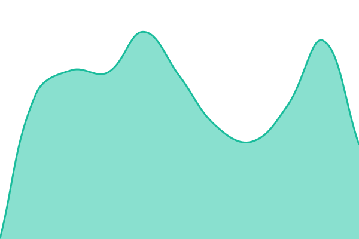

# [📈 Live Status](https://silasantosh.github.io/status): <!--live status--> **🟩 All systems operational**

This repository contains the open-source uptime monitor and status page for [Sila Santosh Kumar](https:://silasantosh.com), powered by [Upptime](https://github.com/upptime/upptime).

With [Upptime](https://upptime.js.org), you can get your own unlimited and free uptime monitor and status page, powered entirely by a GitHub repository. We use [Issues](https://github.com/silasantosh/status/issues) as incident reports, [Actions](https://github.com/silasantosh/status/actions) as uptime monitors, and [Pages](https://silasantosh.github.io/status) for the status page.

<!--start: status pages-->
<!-- This summary is generated by Upptime (https://github.com/upptime/upptime) -->
<!-- Do not edit this manually, your changes will be overwritten -->
<!-- prettier-ignore -->
| URL | Status | History | Response Time | Uptime |
| --- | ------ | ------- | ------------- | ------ |
|  [Impact Connect (site)](https://impact-connect.in) | 🟩 Up | [impact-connect-site.yml](https://github.com/silasantosh/status/commits/HEAD/history/impact-connect-site.yml) | 

 189ms
     
 | 

<a href="https://silasantosh.github.io/status/history/impact-connect-site">100.00%</a>
    

|  [Impact Connect (API)](https://api.impact-connect.in/api/health) | 🟩 Up | [impact-connect-api.yml](https://github.com/silasantosh/status/commits/HEAD/history/impact-connect-api.yml) | 

 292ms
     
 | 

<a href="https://silasantosh.github.io/status/history/impact-connect-api">100.00%</a>
    

|  [in-meet (site)](https://in-meet.in) | 🟩 Up | [in-meet-site.yml](https://github.com/silasantosh/status/commits/HEAD/history/in-meet-site.yml) | 

 281ms
     
 | 

<a href="https://silasantosh.github.io/status/history/in-meet-site">100.00%</a>
    

|  [in-meet (API)](https://api.in-meet.in/api/health) | 🟩 Up | [in-meet-api.yml](https://github.com/silasantosh/status/commits/HEAD/history/in-meet-api.yml) | 

 366ms
     
 | 

<a href="https://silasantosh.github.io/status/history/in-meet-api">100.00%</a>
    

|  [in-media](https://in-media.in) | 🟩 Up | [in-media.yml](https://github.com/silasantosh/status/commits/HEAD/history/in-media.yml) | 

 383ms
     
 | 

<a href="https://silasantosh.github.io/status/history/in-media">100.00%</a>
    

|  [in-self](https://in-self.in) | 🟩 Up | [in-self.yml](https://github.com/silasantosh/status/commits/HEAD/history/in-self.yml) | 

 369ms
     
 | 

<a href="https://silasantosh.github.io/status/history/in-self">100.00%</a>
    

|  [in-feeds](https://in-feeds.in) | 🟩 Up | [in-feeds.yml](https://github.com/silasantosh/status/commits/HEAD/history/in-feeds.yml) | 

 316ms
     
 | 

<a href="https://silasantosh.github.io/status/history/in-feeds">100.00%</a>
    

|  [in-learn](https://in-learn.in) | 🟩 Up | [in-learn.yml](https://github.com/silasantosh/status/commits/HEAD/history/in-learn.yml) | 

 209ms
     
 | 

<a href="https://silasantosh.github.io/status/history/in-learn">100.00%</a>
    

|  [in-collab](https://in-collab.in) | 🟩 Up | [in-collab.yml](https://github.com/silasantosh/status/commits/HEAD/history/in-collab.yml) | 

 179ms
     
 | 

<a href="https://silasantosh.github.io/status/history/in-collab">100.00%</a>
    

|  [ATG Foundation](https://atgfoundation.org) | 🟩 Up | [atg-foundation.yml](https://github.com/silasantosh/status/commits/HEAD/history/atg-foundation.yml) | 

 208ms
     
 | 

<a href="https://silasantosh.github.io/status/history/atg-foundation">100.00%</a>
    

|  [ATG HealthCare](https://atghealthcare.in) | 🟩 Up | [atg-health-care.yml](https://github.com/silasantosh/status/commits/HEAD/history/atg-health-care.yml) | 

 254ms
     
 | 

<a href="https://silasantosh.github.io/status/history/atg-health-care">100.00%</a>
    

|  [ATG HealthCare tracker](https://tracker.atghealthcare.in) | 🟩 Up | [atg-health-care-tracker.yml](https://github.com/silasantosh/status/commits/HEAD/history/atg-health-care-tracker.yml) | 

 314ms
     
 | 

<a href="https://silasantosh.github.io/status/history/atg-health-care-tracker">100.00%</a>
    

|  [ATG Foundation tracker](https://tracker.atgfoundation.org) | 🟩 Up | [atg-foundation-tracker.yml](https://github.com/silasantosh/status/commits/HEAD/history/atg-foundation-tracker.yml) | 

 448ms
     
 | 

<a href="https://silasantosh.github.io/status/history/atg-foundation-tracker">100.00%</a>
    

<!--end: status pages-->

[**Visit our status website →**](https://silasantosh.github.io/status)

## 📄 License

- Powered by: [Upptime](https://github.com/upptime/upptime)
- Code: [MIT](./LICENSE) © [Anand Chowdhary](https://anandchowdhary.com)
- Data in the `./history` directory: [Open Database License](https://opendatacommons.org/licenses/odbl/1-0/)
